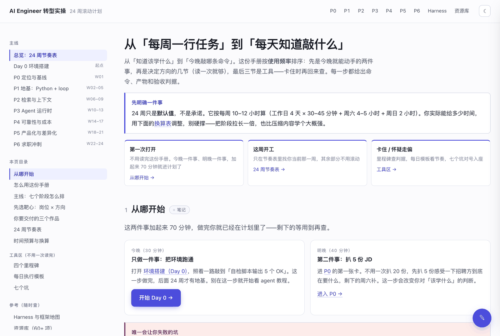
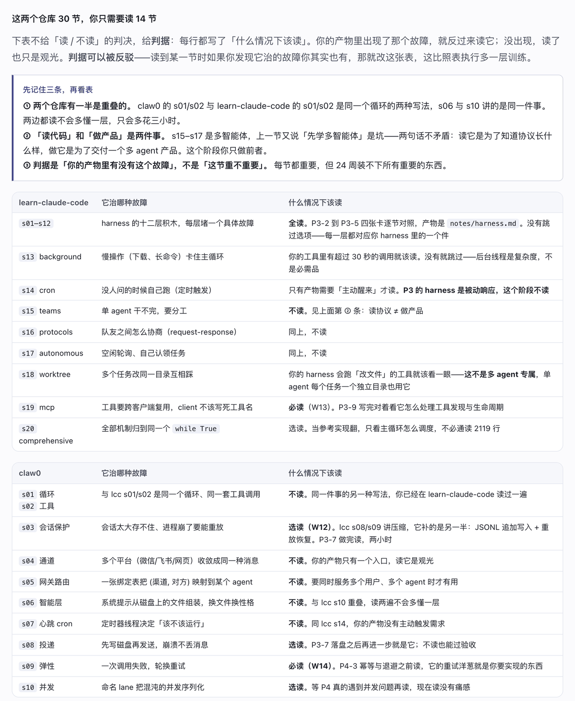
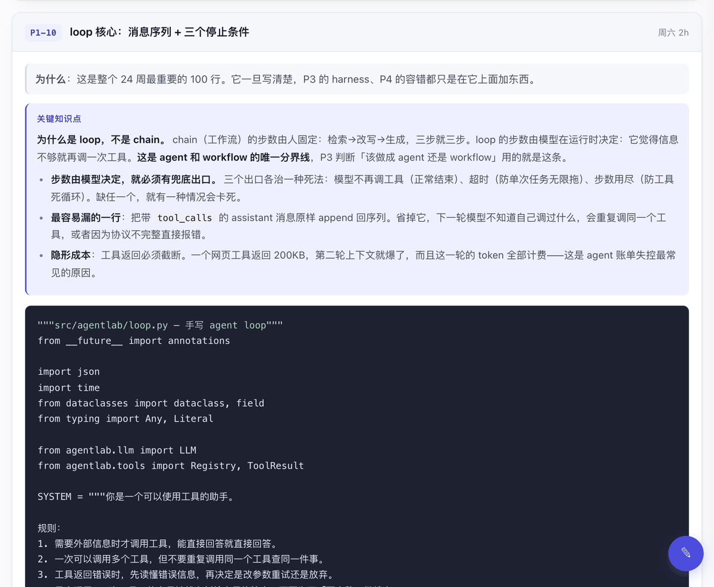
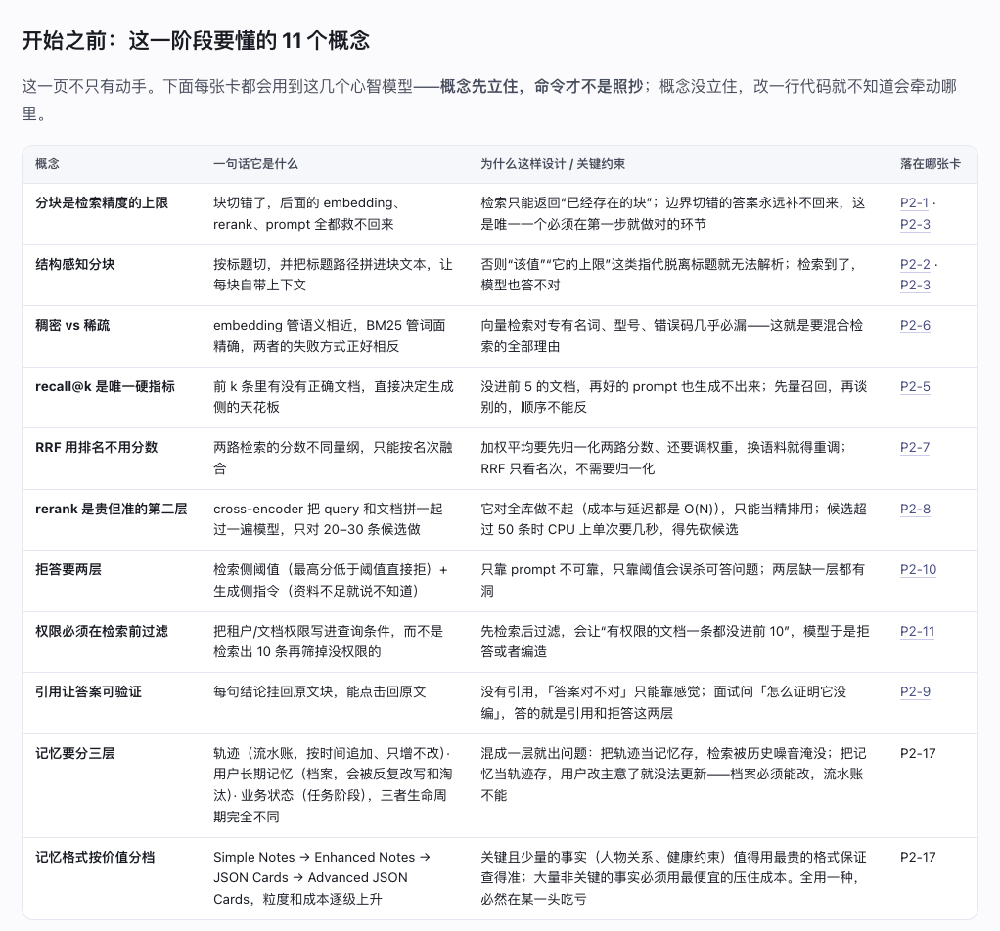

# AI Engineer 转型实操手册

**给前端工程师的 24 周转型计划：83 张任务卡，每张都带命令、产物和验收判据。**

[**→ 在线浏览**](https://wilbertian.github.io/AI-engineer-plan/) ｜ [从哪开始](#从哪开始) ｜ [它跟别的路线图有什么不同](#它跟别的-ai-学习路线图有什么不同)



## 这是什么

给有几年工程经验、想转到 AI / Agent 工程岗的前端。不是课程，是一份**执行手册**：24 周、7 个阶段、83 张任务卡。

每张卡固定六段，缺一段就不算完成：

| 段     | 回答什么              |
| ----- | ----------------- |
| 为什么   | 这件事不做会怎样，为什么顺序不能换 |
| 怎么做   | 可运行的代码 + 一条能敲的命令  |
| 产物    | 落在仓库哪个文件，长什么样     |
| 验收    | 什么数字算过，怎么自查       |
| 卡住怎么办 | 最常见的三种失败和对应动作     |

另外 **62 个概念**（每个阶段开头一张表：一句话是什么 / 为什么这样设计 / 落在哪张卡）和 **14 处关键知识点**（概念重、代码多的卡里，先讲机制再给代码）。

## 它跟别的 AI 学习路线图有什么不同

四条，都可以反驳：

1. **给判据，不给清单。** 阶段为什么这么切、源码该读哪节、方向该补什么，写的都是「什么条件下该这么做」而不是「你该学这些」。判据可以被你反驳，清单不能。
2. **每张卡必须有产物和验收。** 没有「了解一下」这种卡。验收大多是数字：recall@5 到多少、成本降 30% 的 eval 证据、首字 < 2s 的实测截图。
3. **代码可以交给 AI 写，判断力不行。** 卡里的代码是给你跑通、读透、改坏、再 debug 的样本。判断标准很直白：AI 五分钟能生成的不是重点；AI 生成后你无法验证、无法解释、无法改进的，才是重点。
4. **读源码也讲判据。** 两个参考仓库（`learn-claude-code` 20 节 + `claw0` 10 节）共 30 节，逐节标了「它治哪种故障 / 什么情况下该读」——只有 14 节必读，不读的 10 节也写清了为什么不读。



## 一张任务卡长什么样



任务卡是折叠的，能直接深链到某一张（`stage-p1.html#p1-10`）。同一张卡内，**关键知识点放在代码之前**——概念先立住，改一行代码才知道会牵连哪里。

## 每个阶段开始之前，先立 7–10 个概念



62 个概念分布：P0 7 / P1 8 / P2 11 / P3 10 / P4 10 / P5 9 / P6 7。每行都指回具体任务卡，读完概念就能跳到对应卡动手。

## 24 周怎么排

| 阶段 | 周次      | 目标                             | 阶段结束时你手上有                                                     |
| -- | ------- | ------------------------------ | ------------------------------------------------------------- |
| P0 | W01     | 定位与基线                          | 20 份结构化 JD、能力频次表 + 缺口 5 项、简历 v0、目标公司 20 家                     |
| P1 | W02–W05 | 地基：Python + 一个真正能用的 agent loop | `llm.py`、`loop.py`（60–150 行）、`evals/v1.jsonl`（10 条）、一条命令跑出通过率 |
| P2 | W06–W09 | 检索与上下文                         | 200–500 页语料索引、三种分块 recall@5 对比、带引用的问答接口、30 条 eval、跨会话用户记忆             |
| P3 | W10–W13 | Agent 运行时                      | 可中断恢复的 harness、压缩策略对照表、一个 MCP server、全链路 trace                |
| P4 | W14–W17 | 可靠性、安全与成本                      | 五类故障注入报告、攻击清单 + 残留风险、成本降 30% 的 eval 证据、p50/p95                |
| P5 | W18–W21 | 产品化与差异化                        | 公开可访问的产品链接、生成式 UI 场景、限额 + 成本看板、消融表、3 个仓库 README               |
| P6 | W22–W24 | 求职冲刺                           | 简历 v3、作品集页、3 个项目 ×（90 秒版 + 8 个追问）、投递记录表                       |

默认按每周 10–12 小时排（工作日 4 天 × 30–45 分钟 + 周六 4–5 小时 + 周日 2 小时）。**24 周不是承诺，是默认值**——站内有一张换算表，能给你多少时间就按多少时间调，硬撑不如把阶段拉长一倍。

## 从哪开始

今晚两件事，加起来 70 分钟，做完你就在计划里了：

1. **30 分钟**：跑通环境（Day 0），照着一路敲到「自检脚本输出 5 个 OK」
2. **40 分钟**：扒 5 份 JD，感受一下招聘方到底在要什么

其余不用先读完。站内首页按**打开频率**排序，不是按知识顺序：

| 你现在的状态    | 去哪              |
| --------- | --------------- |
| 第一次打开     | 从哪开始（两件事，70 分钟） |
| 这周要开工     | 24 周节奏表，找当前那一周  |
| 卡住 / 怀疑走偏 | 里程碑判据、每日模板、七个坑  |

## 技术实现

整站是**纯静态、零依赖**的：没有构建步骤、没有 npm、没有 CDN，所有样式和脚本都在 `assets/` 里，断网也能完整打开。

- 明暗主题（跟随系统 + 手动切换，选择记在 `localStorage`）
- 深链直达任意任务卡，折叠卡会自动展开
- 代码块一键复制
- **学习笔记**：纯前端 `localStorage`，不联网、无后端。可以记在某一节、某张卡（折叠状态也能记）或整页；支持导出 Markdown（按页面顺序，带原文链接）和备份 JSON（换设备时导入还原）。注意它是本机存储，换浏览器/清缓存都不会跟过去，重要内容请定期备份。

## 本地打开

```bash
git clone https://github.com/WilberTian/AI-engineer-plan.git
cd AI-engineer-plan
python3 -m http.server 8000
# 浏览器打开 http://localhost:8000
```

直接双击 `index.html` 也能看，但用本地服务器更接近线上（相对路径、锚点、主题记忆都一致）。

## 目录结构

```
.
├── index.html          总览：按打开频率排序（今晚做什么 → 方向与节奏 → 工具区）
├── env.html            Day 0：uv + Python 3.12、目录骨架、check_env.py
├── stage-p0.html       W01      定位与基线
├── stage-p1.html       W02–W05  地基：Python + 手写 agent loop + 评测 v1
├── stage-p2.html       W06–W09  检索与上下文
├── stage-p3.html       W10–W13  Agent 运行时
├── stage-p4.html       W14–W17  可靠性与成本
├── stage-p5.html       W18–W21  产品化与差异化
├── stage-p6.html       W22–W24  求职冲刺
├── resources.html      资源库（§1–§15）：Harness 地图、30 节判据表、书按周读法、术语表
├── 404.html            GitHub Pages 的自定义 404
├── assets/
│   ├── style.css       设计系统（明暗主题、响应式、笔记面板）
│   ├── app.js          主题、进度条、目录高亮、代码复制、深链展开、学习笔记
│   └── readme/         本文档用到的截图
├── .nojekyll           告诉 GitHub Pages 不要走 Jekyll
└── README.md
```

## 部署与维护

页面之间的链接全部是相对路径，所以放在仓库根目录或子目录都能工作。当前仓库的 Pages 设置是 **Settings → Pages → Deploy from a branch → `main` / `/ (root)`**。

改完文件 `git commit && git push`，Pages 通常 30–60 秒重建。手机上已打开的页面下拉刷新即可（`app.js` 不缓存内容）。

站内已去掉 `noindex`，可以被搜索引擎收录；想恢复「能打开但不被检索」，在需要的页面 `<head>` 里加回 `<meta name="robots" content="noindex,nofollow">`。

## 关于内容

- **数字与 API 有保质期。** 市场数字、版本号、API 名称的事实核对截止到 2026 年 10 月。页面里标了哪些是「占位值、需要用自己的数据标定」——这类数字（薪资区间、岗位匹配度）请按你所在城市和你自己的样本重新算，不要直接引用。
- **不承诺结果。** 这份计划不会让谁「4 个月薪资翻倍」。它能让一个有几年经验的工程师，在半年后具备拿到 AI 应用工程面试、并把项目讲得住的能力。剩下的取决于市场、城市，以及你愿不愿意在第一批被拒之后继续改材料。
- **不适合谁。** 不适合零基础学编程的人（默认你已经能独立写代码、能读别人的代码）；也不适合想跳过动手、只要一份知识图谱的人——这里没有只读不做的卡。
- **使用与转载。** 内容可自由阅读、转发链接、摘录引用（注明出处即可）；未经许可请勿整体商用或去掉出处二次分发。

## 反馈

内容有错、口径过时、某张卡照着做不通——开 issue 说明具体是哪一张、卡在哪一步。判据类的内容欢迎附上反例反驳。
